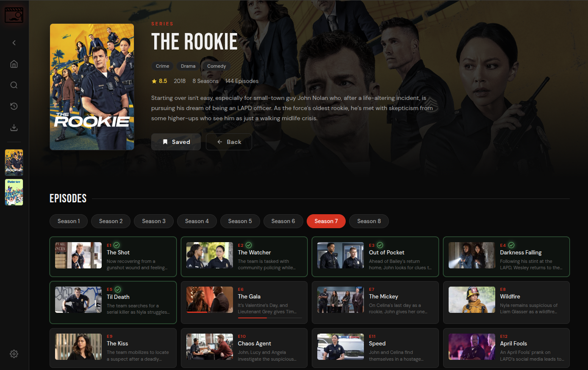
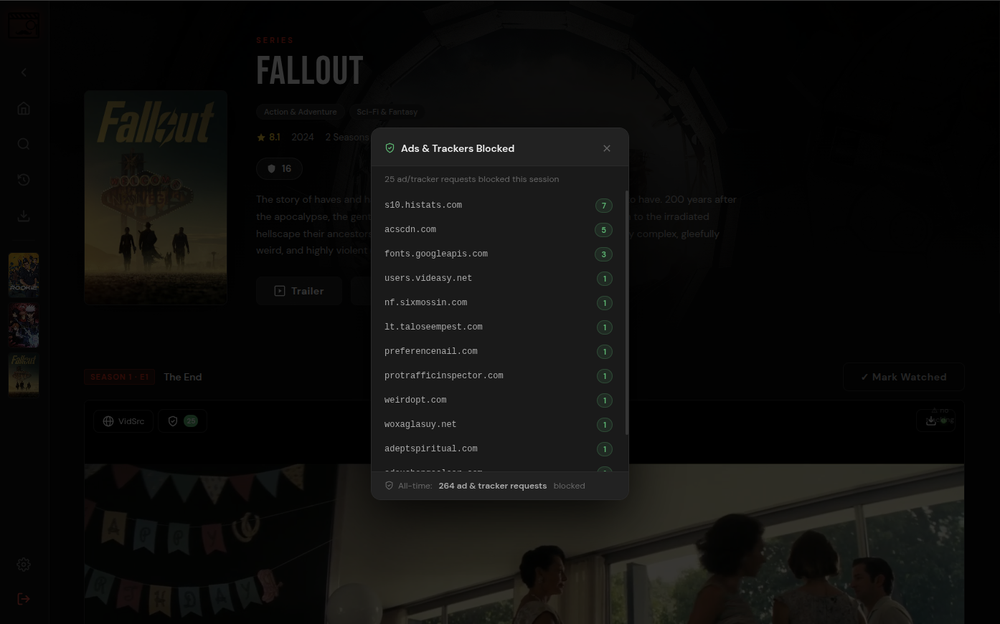
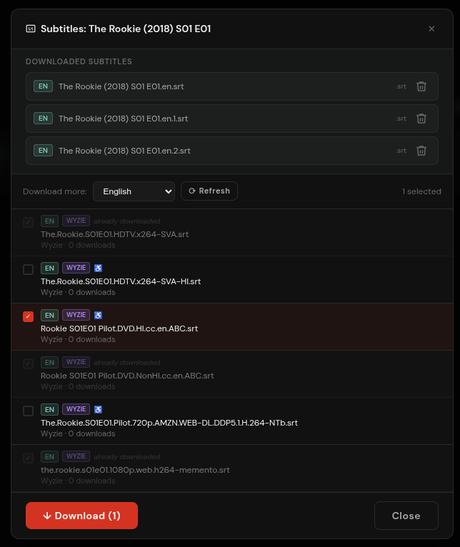
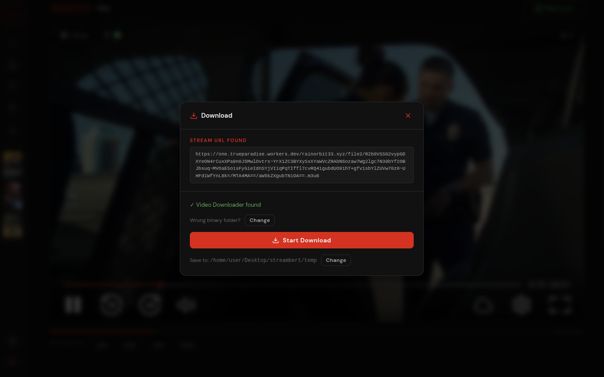

[](https://codeberg.org/truelockmc/streambert/releases/latest/)
[](https://github.com/truelockmc/streambert/releases)
[](https://github.com/truelockmc/streambert/issues)
[](https://github.com/truelockmc/streambert/issues?q=is%3Aissue+is%3Aclosed)<br>

[](https://github.com/truelockmc/streambert)
[](https://codeberg.org/truelockmc/streambert)
[](https://aur.archlinux.org/packages/streambert-bin)
# Streambert
A cross-platform Electron Desktop App to stream and download any Movie, TV Series or Anime in the World. Zero Ads and Tracking[*](#privacy-disclaimer) <br></br>
<a href="https://trendshift.io/repositories/31115" target="_blank" rel="noopener noreferrer"></a>


[Installation](#requirements)

## Why Streambert?
- 🎦 **Streaming:** Stream any Movie, Anime or TV Series from around the World.
- 📥 **Downloading:** Download anything you want to watch.
- 📃 **Subtitles:** Download and manage Subtitles.
- ⚙️ **Customizability:** Customize the Interface and Features to your unique needs.
- 📚 **Library:** Track what you watched, save stuff you want to watch and manage your Downloads.
- ✨ **Trending:** Discover new things to Watch every Day.
- 🛡️ **Privacy:** Completely Ads and Tracker free, forever.
- ⚡ **Speed:** Stream faster than any Browser can, download with multithreading.










---
[](https://github.com/truelockmc/streambert/stargazers)
---
## Streaming
The Application gets video streams from different hosters/aggregators, see [PLAYER_SOURCES](src/utils/api.js). <br></br>
It fetches Information for Images, Info Texts, Search and Homepage from [tmdb](https://www.themoviedb.org/).

### A source plays the wrong series

Some episodes on a source are a different series that shares the name. Doctor Who (2005, TMDB `57243`) season 1 episodes 1–3 on Vidrift are the 2024 series, so those three play on VidSrc. The Eleventh Hour and every other episode of that show stay on the saved source. The saved source itself is not changed.

`whoEpisode` in [src/utils/episodeMatch.js](src/utils/episodeMatch.js) is that list (`WHO_EPISODES`). Another show is another row:

```js
{
  id: 57243,          // TMDB show id
  season: 1,
  episodes: [1, 2, 3],
  source: "vidrift",  // the source whose file is the wrong series
  playOn: "vidsrc",   // the source that has the right episode
}
```

Only those episodes switch, and only when the saved source is `source`. The rest of the show stays on the saved source, including after one of the bad episodes has played.

Vidrift also checks the opening English captions against the episode title. Captions that contradict the title leave that source for that episode. A file with no captions stays, so a known case still needs a row. Do not add a whole show because one episode was wrong.

---

## Downloading
You can download those Video Streams because the Program sources Links to their .m3u8 Playlist Files ([similar to this Browser Extension](https://addons.mozilla.org/en-US/firefox/addon/m3u8-link-finder/)). <br></br>
Once you click 'Download' these Links are used to download the Full Movie/TV Episode using [this Program](https://github.com/truelockmc/vid-dl-cli-only). You can then watch them In-App or take the Files on any Storage Medium you want.

---

## Anime
You can also watch Anime, the App checks if a Movie or Series is an Anime and then sources its Metadata from [AniList](https://anilist.co/) instead of [tmdb](https://www.themoviedb.org/). <br></br>
Media Files for Animes are scraped from AllManga.to (i stole this mechanic from [ani-cli](https://github.com/pystardust/ani-cli)). The App directly gets .mp4 Files and doesnt evem show you the AllManga website, you can also download these Files, just like any other Content.


## Requirements

- [Node.js](https://nodejs.org/) (>=22.12.0) installed (only if you aren't using [prebuilt Binaries](https://codeberg.org/truelockmc/streambert/releases/latest))
- A free TMDB API Read Access Token ([Guide on how to get one](tmdb-tutorial.md))
- For downloading, [this Program](https://github.com/truelockmc/vid-dl-cli-only/releases/latest) somewhere on your PC and [ffmpeg](https://ffmpeg.org/download.html) installed

---
## Installation
On first launch you'll be prompted to enter your TMDB API key. ([Guide on how to get one](tmdb-tutorial.md))
It's saved locally, you only need to do this once.

### Linux, Manual (.deb / .AppImage / .pacman)

Download the latest `.deb` `.pacman` or `.AppImage` from the [Releases](https://codeberg.org/truelockmc/streambert/releases/latest) page.
```bash
# .deb
sudo dpkg -i streambert_*.deb

# Arch Linux (.pacman)
sudo pacman -U streambert-*.pacman

# .AppImage (you can also do it with Gearlever)
chmod +x Streambert-x64.AppImage && ./Streambert-x64.AppImage
```

### Windows

Download the latest `Streambert Setup *.exe` from the [Releases](https://codeberg.org/truelockmc/streambert/releases/latest) page and run it.

### macOS
Download the latest `Streambert-*-universal.dmg` from the [Releases](https://codeberg.org/truelockmc/streambert/releases/latest) page, open it and drag Streambert to your Applications folder.

### Fire TV Stick

The Stick build is a sideload, not an Amazon Appstore app. The APK in `firetv/` is a shell with two WebViews. One loads the Streambert UI. Playback opens in a second fullscreen WebView, because the embed hosts refuse to be iframed.

The Stick does not bundle the app. It loads a dev server on your computer.

1. In `firetv/app/src/main/res/values/strings.xml`, set `start_url` to your computer's address:

```xml
<string name="start_url">http://YOUR_LAN_IP:5173/?tv=1</string>
```

Use your own LAN address. Do not commit it.

2. From the repo, start the dev server and leave that computer awake:

```bash
npx vite --host
```

The TMDB token stays in `.env` as `VITE_TMDB_API_KEY`. That file is gitignored. Restart Vite after changing it. If the server is down, the Stick says it can't reach Streambert. Select retries.

3. Turn on ADB on the Stick, then install and open the shell. The Stick and the computer have to be on the same network.

```bash
adb connect YOUR_STICK_IP:5555
adb -s YOUR_STICK_IP:5555 install -r firetv/streambert-tv.apk
adb -s YOUR_STICK_IP:5555 shell am force-stop com.streambert.tv
adb -s YOUR_STICK_IP:5555 shell am start -n com.streambert.tv/.MainActivity
```

`?tv=1` turns on the remote layout. A Fire TV browser user agent does too, and so does `localStorage` key `streambert_tv`. `?tv=0` turns it off.

On the remote, the D-pad moves focus and Select activates the focused control. Back leaves the current screen. While something is playing, Left and Rewind go back 10 seconds, Right and Fast-forward go forward 10 seconds, and Select presses Skip intro when that button is on screen. Otherwise Select pauses. Play pauses too.

If your computer's LAN address changes, edit `start_url` and rebuild the APK. The shell keeps the URL it was built with.

Build from `firetv/` with `./gradlew assembleDebug` (compile SDK 34, min SDK 21, Java 17). [`fire-tv-setup.readme`](fire-tv-setup.readme) has the manual build for when a full Gradle run is not practical, plus the rest of the remote behavior.

---

## Building from Source
1. Install dependencies:
```bash
npm install
```
2. Build
```bash
npm run dist:win   
```
or
```bash
npm run dist:linux 
```
or (for Arch Linux)
```bash
npm run dist:arch
```
or (for an AppImage only)
```bash
npm run dist:appimage
```
or (for a .deb only)
```bash
npm run dist:deb
```
or (for a .rpm only)
```bash
npm run dist:rpm
```
or (for macOS)
```bash
npm run dist:mac
```
or (build all platforms at once)
```bash
npm run dist
```

> [!IMPORTANT]
> If you are building/installing on Arch Linux and encounter errors, you may need these libraries:
> - **libcrypt.so.1 error:** `sudo pacman -S libxcrypt-compat`
> - **http-parser dependency error:** `yay -S http-parser` (from AUR)

## License
This project is open-source software licensed under the GNU General Public License v3.0 [(GPL-3.0)](LICENSE).

Forks may be created but they MUST stay open-sourced.

## Contributing
Everyone is welcome to contribute to this project.
Before contributing please make sure to read the [Contributing Guidelines](CONTRIBUTING.md) and act accordingly.

## Privacy Disclaimer
Streambert itself does not collect ANY data. There is no centralized service which the app relies on.
However, the streaming sources and github (for downloading updates in-app) may still collect your data.

Streambert has built-in tracker/- and adblocking, but obviously that is not perfect.

## Legal Disclaimer

**IMPORTANT: This application is for educational and personal use only.**

- Streambert does not host, store, or distribute any copyrighted content
- All content is sourced from third-party providers and websites
- Users are solely responsible for ensuring they have legal rights to access any content
- The developer does not endorse or encourage copyright infringement
- Users must comply with all applicable laws in their jurisdiction
- Any legal issues should be directed to the actual content providers
- This app functions as a search engine aggregator only
- No copyrighted material is stored on my side

## Legal Notice

This application is provided "as is" for educational purposes. The developer:
- Does not claim ownership of any content
- Does not profit from copyrighted material in any way
- Does not control third-party content providers
- Encourages users to support content creators through legal means

[](https://repostars.dev/?repos=truelockmc%2Fstreambert&theme=dark)

<details>
    <summary>Project Structure</summary>
    
```
Project Root
├── index.html
├── main.js
├── package.json
├── preload.js
├── vite.config.js
├── LICENSE
├── README.md
├── public
│   ├── icon.png
│   ├── installer-sidebar.bmp
│   └── logo.svg
├── screenshots
│   ├── adblock.png
│   ├── anime.png
│   ├── api-settings_tmdb.png
│   ├── application_tmdb.png
│   ├── download.png
│   ├── icon.png
│   ├── movie.png
│   ├── personal-use_tmdb.png
│   ├── series.png
│   ├── setup.png
│   ├── signup_tmdb.png
│   ├── subs.png
│   ├── token_tmdb.png
│   └── trending.png
└── src
    ├── App.jsx
    ├── main.jsx
    ├── components
    │   ├── BlockedStatsModal.jsx
    │   ├── CloseConfirmModal.jsx
    │   ├── DownloadModal.jsx
    │   ├── ErrorBoundary.jsx
    │   ├── Icons.jsx
    │   ├── KeyboardShortcutsModal.jsx
    │   ├── MediaCard.jsx
    │   ├── SearchModal.jsx
    │   ├── SetupScreen.jsx
    │   ├── Sidebar.jsx
    │   ├── SubtitleDownloaderModal.jsx
    │   ├── TrailerModal.jsx
    │   ├── TrendingCarousel.jsx
    │   ├── UpdateModal.jsx
    │   └── WindowTitlebar.jsx
    ├── ipc
    │   ├── allmanga.js
    │   ├── blockStats.js
    │   ├── downloads.js
    │   ├── player.js
    │   ├── storage.js
    │   └── subtitles.js
    ├── pages
    │   ├── DownloadsPage.jsx
    │   ├── HomePage.jsx
    │   ├── LibraryPage.jsx
    │   ├── MoviePage.jsx
    │   ├── SettingsPage.jsx
    │   └── TVPage.jsx
    ├── styles
    │   ├── global.css
    │   └── fonts
    │       ├── bebas-neue-regular.woff2
    │       ├── dm-sans-300.woff2
    │       ├── dm-sans-500.woff2
    │       ├── dm-sans-600.woff2
    │       └── dm-sans-regular.woff2
    └── utils
        ├── ageRating.js
        ├── aniSkip.js
        ├── api.js
        ├── appearance.js
        ├── backup.js
        ├── episodeMappings.js
        ├── homeLayout.js
        ├── storage.js
        ├── subtitles.js
        ├── updates.js
        ├── useBlockedStats.js
        └── useRatings.js
```
</details>
